# The Spice Route: Across Seven Seas — The Complete Voyage (Chapters I–IV)

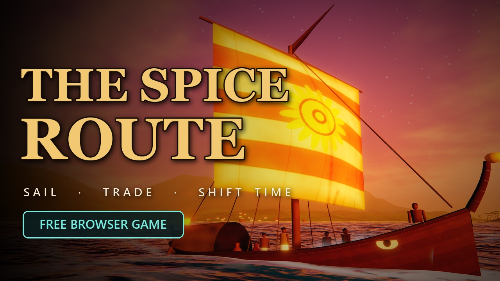

*A GitHub Game Off 2026 entry. Theme: **SHIFT**.*

> "The sea remembers every journey."

Sail an ancient stitched-plank trading ship out of **Muziris** on the Malabar Coast of Kerala,
carrying a sealed package across the western sea before the monsoon turns. Trade spices, read
the wind, survive a monsoon squall, fight off the Hidden Cartographers, and use your missing
father's bronze compass to **shift** between the present and the sea's memory of the past.

## Chapter II — The Gate of Tears

Pick **CHAPTER II** on the title screen (or *Continue to Chapter II* after Chapter I's ending).

The chart Raghavan hid points west. Sail from Ras al-Mira with frankincense and myrrh, cross a
fog-bound reef coast by following ancient beacons that only the **Era Shift** reveals, sell your
cargo in **Aden** (a walled port inside a volcanic crater), and learn from Zahra the scribe what
happened to your father. Then, at night, slip through the **Gate of Tears** past the Hidden
Cartographers' watchtower beams and lantern-lit patrol boats, read the echo of the Vellimeen's
last battle, and face the flagship **Black Compass** at dawn.

New in Chapter II: night and fog weather, **lantern stealth** (press **L** to douse your lantern;
a detection meter fills while you are in a beam or a patrol's lantern light), a boss ship with an
escort, new goods, and a new map of the Gulf of Aden and the Red Sea mouth.

## Chapter III — The Great Marketplace

Pick **CHAPTER III** on the title screen (or continue from Chapter II's ending).

The Black Compass's ledger says Raghavan is a prisoner in Alexandria. Sail north from Berenike up
the Red Sea and into the long-silted **Canal of the Pharaohs**, where the Era Shift reveals the
obelisks of the old kings. The new **Tide Shift** mechanic makes the sea rise and fall: sandbars
ground you at low tide, so watch the tide gauge and cross at high water. In **Alexandria**, beneath
the Pharos lighthouse, sell your cargo at the Great Marketplace, pay a harbour clerk for the truth,
then return at night to slip past the lighthouse's spinning beam, free your father from the prison
galley *Iron Ledger*, and escape the harbour with two raiders on your stern.

## Chapter IV — Across Seven Seas (the finale)

Pick **CHAPTER IV** on the title screen (or continue from Chapter III's ending).

Raghavan is home, and the old chart points south, beyond the edge of every known map. Meet two
**Guild ships** at the Cape of Lanterns. They join your fleet, follow your wake and fight beside you.
Cross the **Storm Wall**, a storm that never ends over a field of reefs, by following a passage of
ancient lamps that only the Era Shift reveals. Read the echo of the **Sunken Archive**, the drowned
city where the first navigators recorded every route of the sea. Then sink the Grand Cartographer's
flagship **The Last Map** and make the final choice. There are four endings: **Merchant King**,
**Guardian of the Seas**, **The Great Navigator** and **The Broken Route**.

New in Chapter IV: allied ships with their own AI, a localized storm region, a map that grows
south past the old edge, a boss fleet battle, and a branching ending.

## Land, crew and the Captain's Ledger

**Go ashore.** Stop the ship near any beach or port and press **F** to land as Arivan. Walk with
**W A S D**, jump with **SPACE**, use things with **E**, and press **F** again to return to the ship.
Light beams mark what is worth walking to: **gold** beams are shops, **teal** beams are discoveries.

- **Shipwrights** sell five upgrades (hull, sails, steering oar, hold, fire-arrows; three levels each,
  all visible on the ship) and four new **ship classes**: Swift Merchant, Great Cargo Ship, War Galley
  and Explorer.
- **Taverns** are where you hire crew, pay wages and throw feasts.
- **Inscriptions** give skill points, **chests** and wild spices give gold, and **vaults** are sealed
  walls whose door exists only in the past: open them with the Era Shift.

**The Captain's Ledger (TAB)** has three pages:

- **Skills.** Three trees (Navigator, Merchant, Warrior) with four skills each. Skill points come
  from story steps, sunk enemies, inscriptions and vaults.
- **Crew.** Up to six sailors, each with a name, origin, personality, wage and skills. Assign them to
  six stations (helm, sails, lookout, archers, carpenter, quartermaster). **Loyalty** rises with paid
  wages, feasts and victories, and falls with unpaid voyages and defeats. Loyal sailors work harder;
  a sailor with no loyalty leaves the ship.
- **Ship.** Upgrades, ship class and current stats.

Progress carries across all four chapters and is saved in the browser.

## Screenshots

| | |
| --- | --- |
| 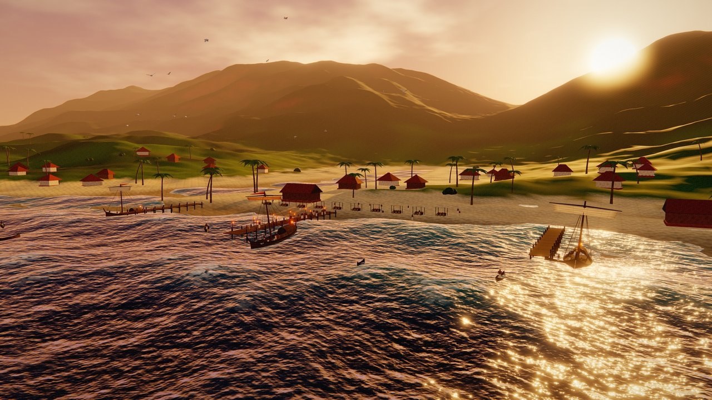 | 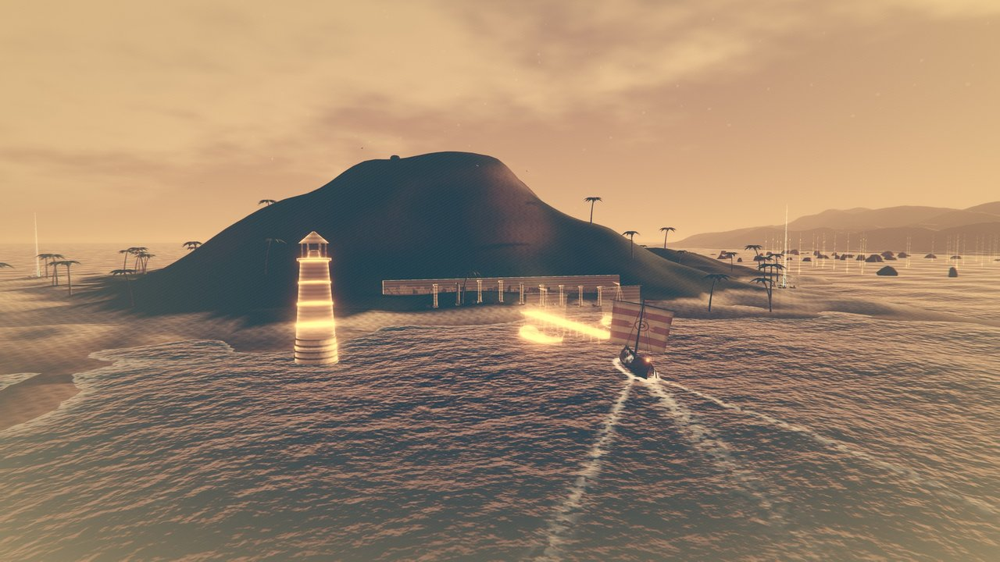 |
| 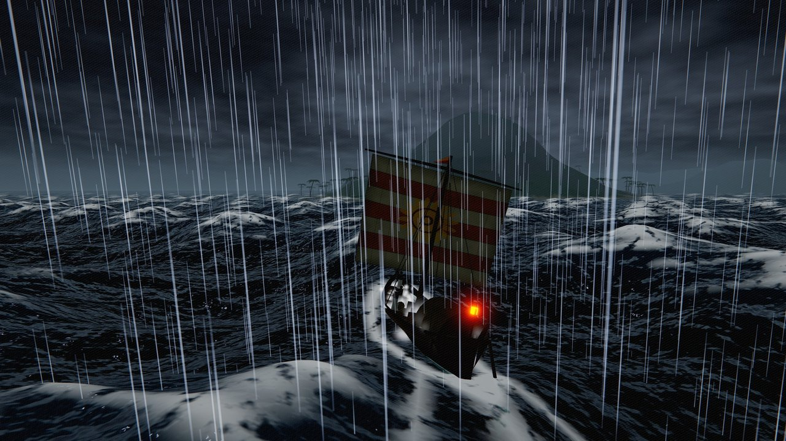 | 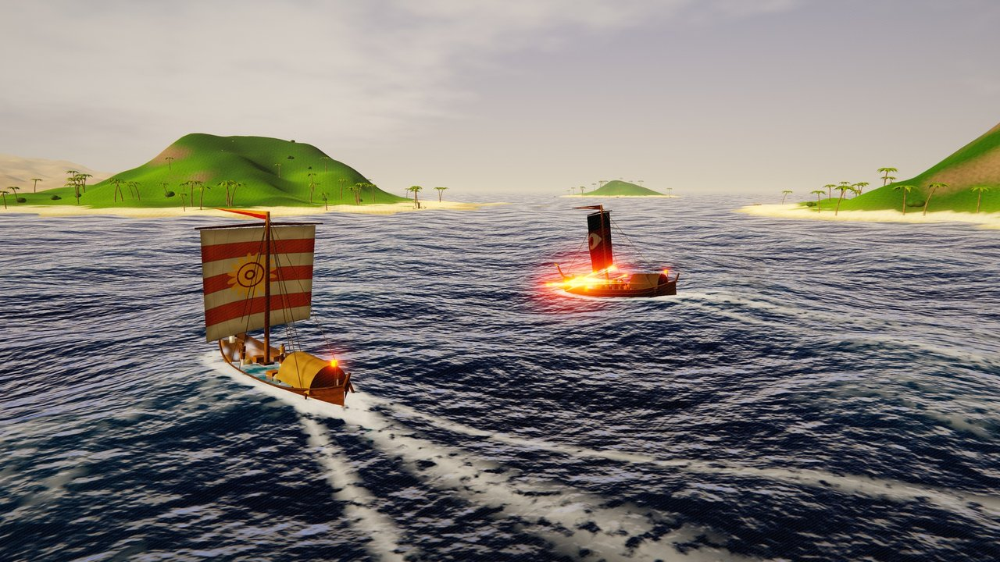 |
| 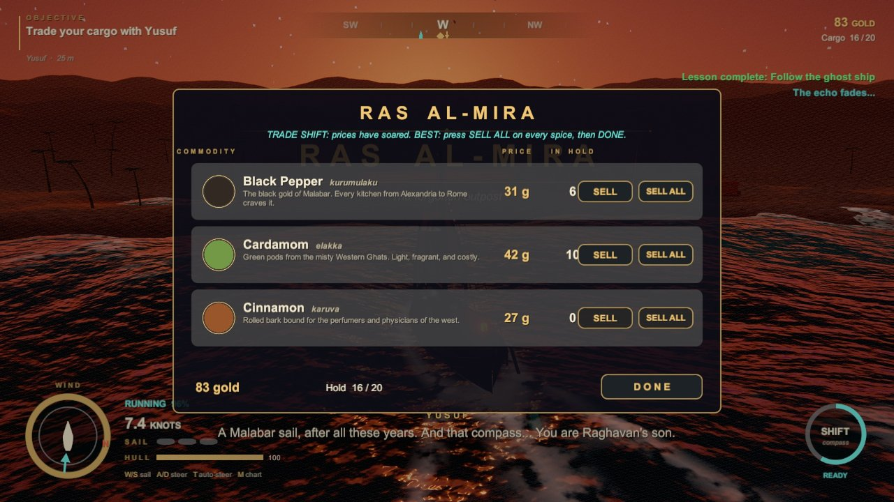 | 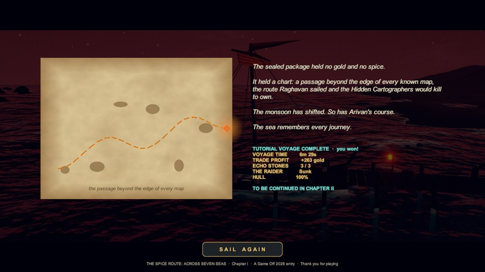 |
| 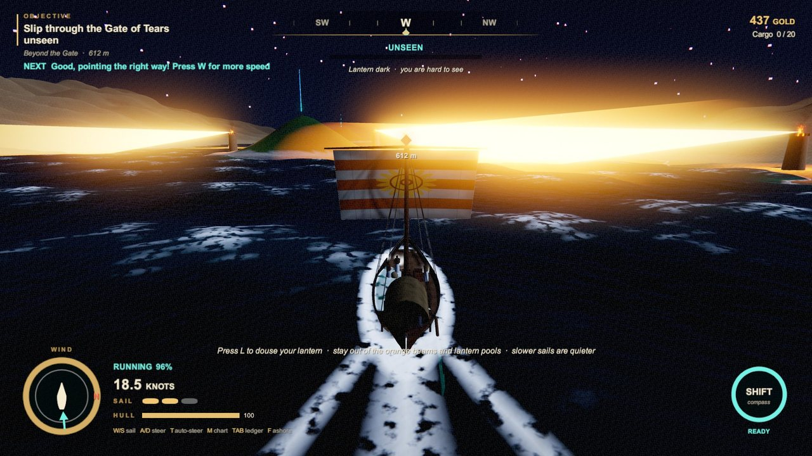 | 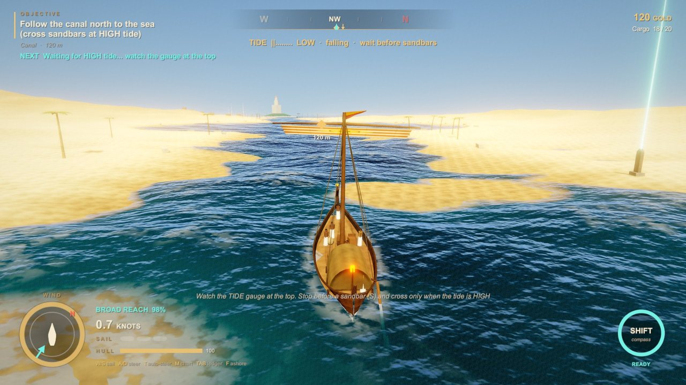 |
| 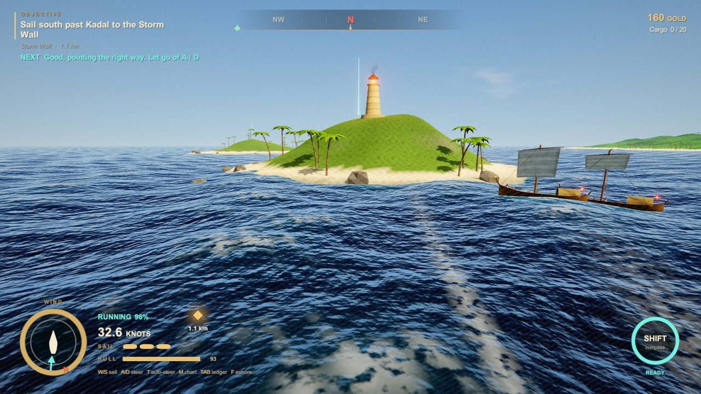 | 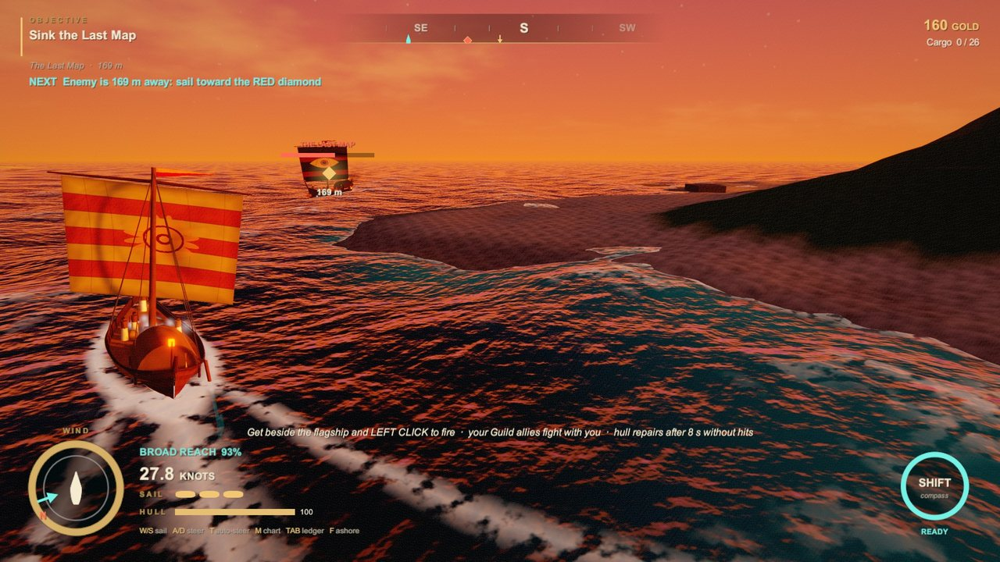 |
| 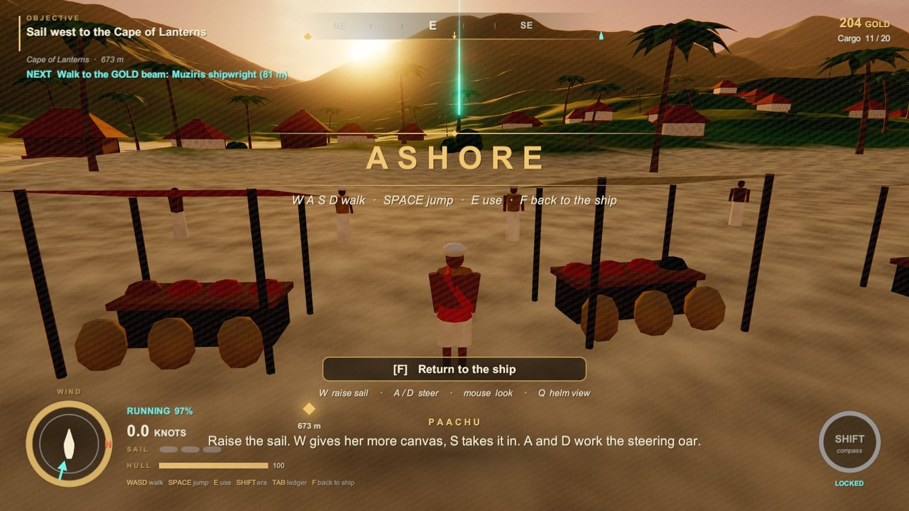 | 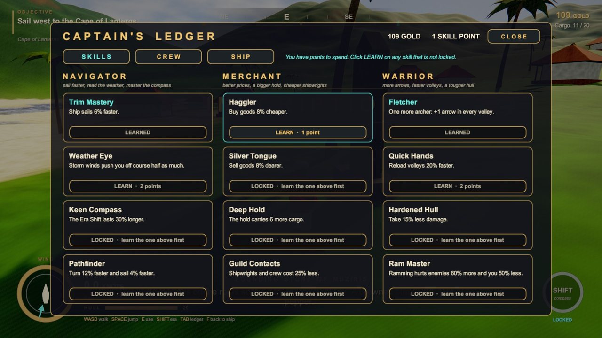 |

## The seven shifts

| Shift | How it plays |
| --- | --- |
| **Wind Shift** | The monsoon turns mid-voyage. A square sail needs the wind behind or beside it; the wind dial shows sail efficiency. |
| **Weather Shift** | A monsoon squall rolls in: rain, lightning, bigger waves, gusts that push you downwind. |
| **Course Shift** | The storm forces you to abandon your heading and run for shelter behind Kadal Island. |
| **Perspective Shift** | Press **Q** to switch between the chase camera and the view from the helm. |
| **Trade Shift** | Buy pepper, cardamom and cinnamon cheap in Muziris; the storm has closed the northern routes, so prices have soared at Ras al-Mira. |
| **Era Shift** | Press **SHIFT** to see the Isle of Echoes as it once was: ghost harbours, echo stones that hold your father's last words, and an ancient channel through the hidden reefs. |

## Tutorial Voyage

Choose **TUTORIAL VOYAGE** on the title screen for a guided run of the whole chapter. The
*Captain's Lessons* panel (left side) walks through 17 lessons, from taking the helm and trading to
reading the wind, the storm, broadside archery, the Era Shift, following the Vellimeen, selling and
opening the package. Each lesson explains the controls, gives the **best action**, tracks a task with a
checkbox, and a live coach line tells you what to do right now ("target is to the left: hold A",
"BROADSIDE READY: LEFT CLICK", "press SHIFT now"). Assists: 260 starting gold, 55% less hull damage,
a stronger monsoon (+30% speed), a weaker raider, a longer-lasting compass, and gentle bumps instead of
crash damage when touching land. Lessons are written for first-time players, and a red **SHALLOW WATER
AHEAD** warning plus **T auto-steer** are available in every mode.

## Controls

| Key | Action |
| --- | --- |
| W / S | Raise / lower the sail (three settings) |
| A / D | Steering oar |
| Mouse | Look around (click the game to take the helm) |
| Scroll | Camera distance |
| SHIFT | Era Shift |
| T | Auto-steer toward the gold diamond (steers around land) |
| L | Douse / light your lantern (Chapter II stealth) |
| Q | Perspective Shift (helm view) |
| E | Interact (trade, open) |
| Left click | Loose a volley of fire-arrows (turn broadside first) |
| Right click (hold) | Aim the volley |
| M | Your father's chart |
| Enter | Skip a dialogue line |
| P | Pause |
| F3 | Show FPS |

## Technical notes

- **Unity 6 (6000.4)**, built-in render pipeline, WebGL 2.
- **No imported assets.** Every mesh (ships, palms, Kerala houses, the temple and lamp tower,
  ruins, terrain), every texture (sail cloth, parchment, noise), every sound effect and all four
  music tracks are generated in code at load time.
- Custom shaders: Gerstner-wave ocean with depth-based shallows, shore foam and ship wakes;
  procedural sky with clouds, stars and lightning; triplanar-detail surface shader with palm sway
  and storm wetness; billowing sail cloth; additive "memory" ghost shader.
- Custom post stack: bloom, ACES tonemapping, grading, vignette, and the Era Shift memory grade with
  ripple and chromatic aberration.
- The ship model: square-sail point-of-sail efficiency, steering-oar turning, wave buoyancy
  sampled from the same Gerstner field as the GPU, land and reef collisions, fire damage and sinking.
- Music is inspired by Kerala traditions: tanpura drone, a bansuri-style flute with gamaka in
  Raga Mohanam, mizhavu and chenda drums, ilathalam cymbals, conch horns, and Mayamalavagowla
  bells for the Era Shift.

## Building

The project is built with the Unity CLI:

```bash
unity build . --target WebGL --execute-method BuildScript.BuildWebGL --output-path Builds/WebGL --allow-dirty-build
```

`BuildScript.BuildWebGL` (in `Assets/Editor/BuildScript.cs`) creates the single scene, applies the
WebGL player settings (Gzip with decompression fallback, the custom `SpiceRoute` WebGL template), and
builds. To publish on itch.io, zip the *contents* of `Builds/WebGL` (with `index.html` at the root),
upload it as an HTML game, and set the viewport to 1280 × 720 with fullscreen enabled.

## Automated testing and media capture

The Windows player has two command-line modes, used to test the game and to make its marketing media:

```bash
SpiceRoute.exe -autoplay [-tutorial] [-chapter 2|3|4] [-choice 0-3] [-landtest] -shots <folder>
```

A bot plays the whole chapter from the title screen to the ending. It logs every story step, flags any step where it gets stuck, dies or loses the HUD, and saves screenshots. See `Assets/Scripts/Gameplay/Autoplay.cs`.

```bash
SpiceRoute.exe -capture -out <folder>
```

Renders scripted cinematic shots at a locked 30 fps (1920×1080 frames plus 4K stills) and exports the synthesised music and sound effects. `Tools/media/make_media.py` turns that into the trailer, thumbnails, itch.io cover and screenshots; `Tools/media/make_itch_page.py` builds the itch.io page theme kit. See `Assets/Scripts/Gameplay/Director.cs`.

## Code map

| Folder | Contents |
| --- | --- |
| `Assets/Scripts/Game.cs` | Bootstrap, game states, player input, combat input, checkpoints |
| `Assets/Scripts/Gameplay` | Story beats, Era Shift, market and economy, progression (`Progress.cs`), land exploration (`Shore.cs`) |
| `Assets/Scripts/Ship` | Procedural ship builder, ship simulation, combat, raider AI, allied fleet AI |
| `Assets/Scripts/World` | Wave field, ocean, sky and weather, wind, terrain, props, world layout |
| `Assets/Scripts/Audio` | Offline synthesiser and audio manager |
| `Assets/Scripts/UI` | HUD and every screen, built in code |
| `Assets/Resources/Shaders` | All shaders |

The setting, characters and events are fictional, inspired by the historical Indian Ocean trade
between the Malabar Coast and the western world.
