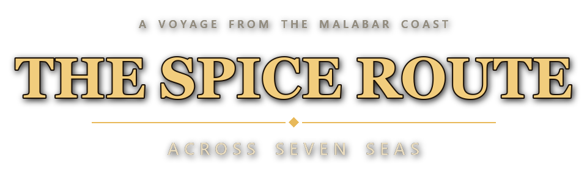

*"The sea remembers every journey."*

**Sail an ancient stitched-plank trading ship out of Muziris on the Malabar Coast of Kerala. Trade spices, read the monsoon, slip past watchfires at night, lead a fleet through a storm that never ends, and use your missing father's bronze compass to SHIFT between the present and the sea's memory of the past.**

A GitHub Game Off 2026 entry  ·  Theme: **SHIFT**  ·  Plays free in your browser  ·  four chapters, about 40 minutes

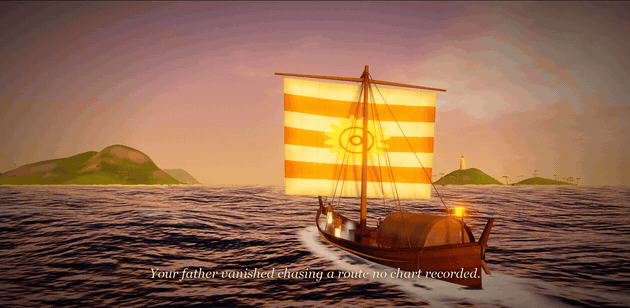

Seven years ago the navigator **Raghavan** sailed west aboard the *Vellimeen*, searching for a route no chart recorded. He never returned.

His son **Arivan** inherited three things: a battered ship named the *Kaveri*, his father's bronze compass, and a promise to find the truth. It begins with a sealed package that must cross the western sea before the monsoon shifts. It ends beyond the edge of every known map.

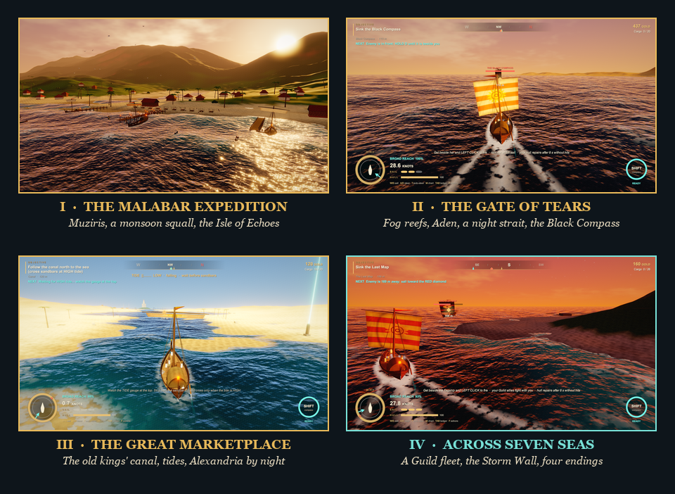

- **I · The Malabar Expedition.** Fill your hold in Muziris, survive a monsoon squall, fight off a raider and read the echoes of a lost expedition.
- **II · The Gate of Tears.** Follow ancient beacons through a fog-bound reef coast, trade in Aden, slip through a guarded strait at night with your lantern doused, and face the flagship *Black Compass*.
- **III · The Great Marketplace.** Sail the silted canal of the old kings on the rising tide, sell your cargo in Alexandria, and free a prisoner under the sweeping beam of the Pharos lighthouse.
- **IV · Across Seven Seas.** Lead a Guild fleet through the Storm Wall to the Sunken Archive, sink *The Last Map*, and choose one of **four endings**.

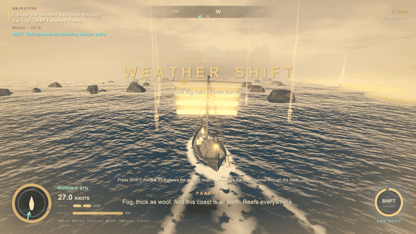

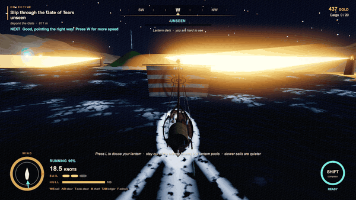

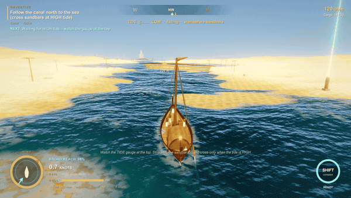

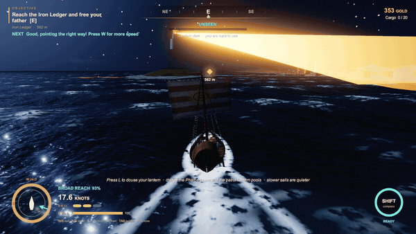

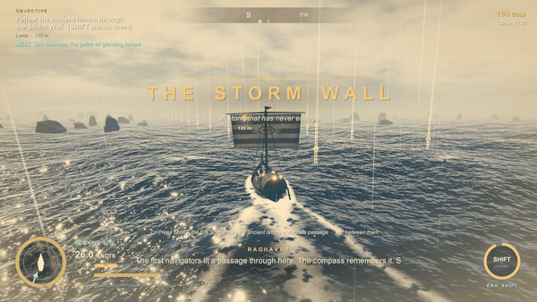

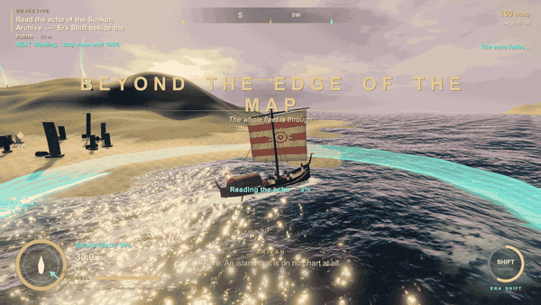

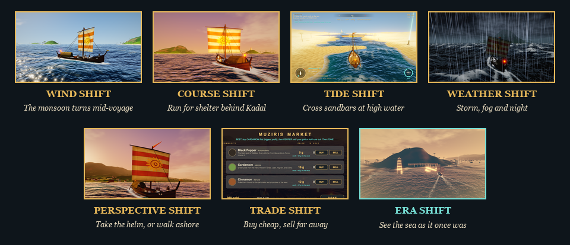

- **Wind Shift**: the monsoon turns mid-voyage. A square sail needs the wind behind or beside it.
- **Course Shift**: abandon your heading and run for shelter when the weather turns.
- **Tide Shift**: the sea rises and falls. Sandbars ground you at low tide, so cross at high water.
- **Weather Shift**: monsoon squalls, sea fog, night, and a storm that never ends.
- **Perspective Shift**: stand at the helm, or leave the ship and walk the shore.
- **Trade Shift**: what is cheap in one port is worth three times as much in the next.
- **Era Shift**: your father's compass shows the sea as it once was: ghost harbours, lost beacons, sunken cities and doors that only exist in the past.

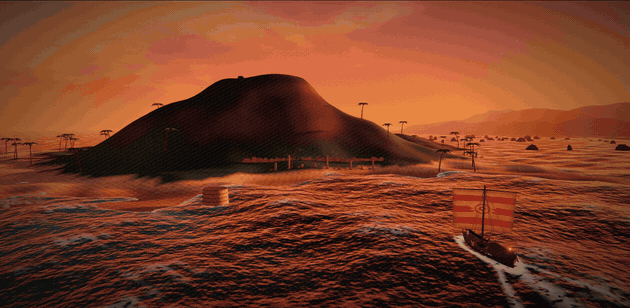

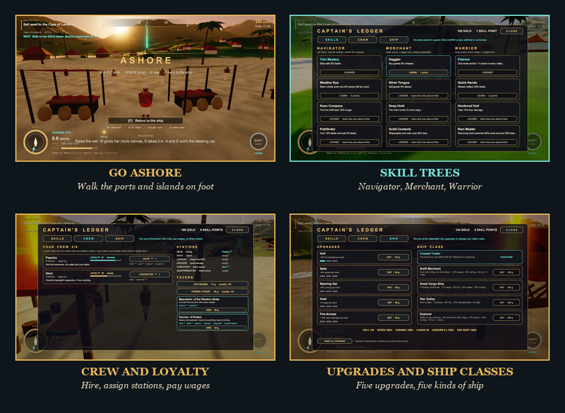

- **Go ashore.** Stop near any beach or port and press **F**. Walk to the light beams: gold beams are shops, teal beams are discoveries.
- **Find things.** Inscriptions give skill points, chests and wild spices give gold, and sealed vaults open only through the Era Shift.
- **Three skill trees.** Navigator, Merchant and Warrior, with four skills each.
- **Upgrade your ship.** Hull, sails, steering oar, hold and fire-arrows, each with three levels you can see on the ship.
- **Five kinds of ship.** Refit the *Kaveri* as a Swift Merchant, Great Cargo Ship, War Galley or Explorer.
- **A crew with loyalty.** Hire up to six sailors, give each a station, and keep them paid. Loyal sailors work harder; unpaid ones leave.

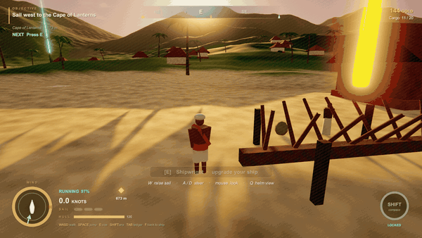

**New to games? Choose TUTORIAL VOYAGE on the title screen.** A lesson panel teaches every button as you play, and a help line always tells you the best next move. The tutorial also turns on assists: lighter damage, a stronger monsoon and gentle bumps instead of crashes.

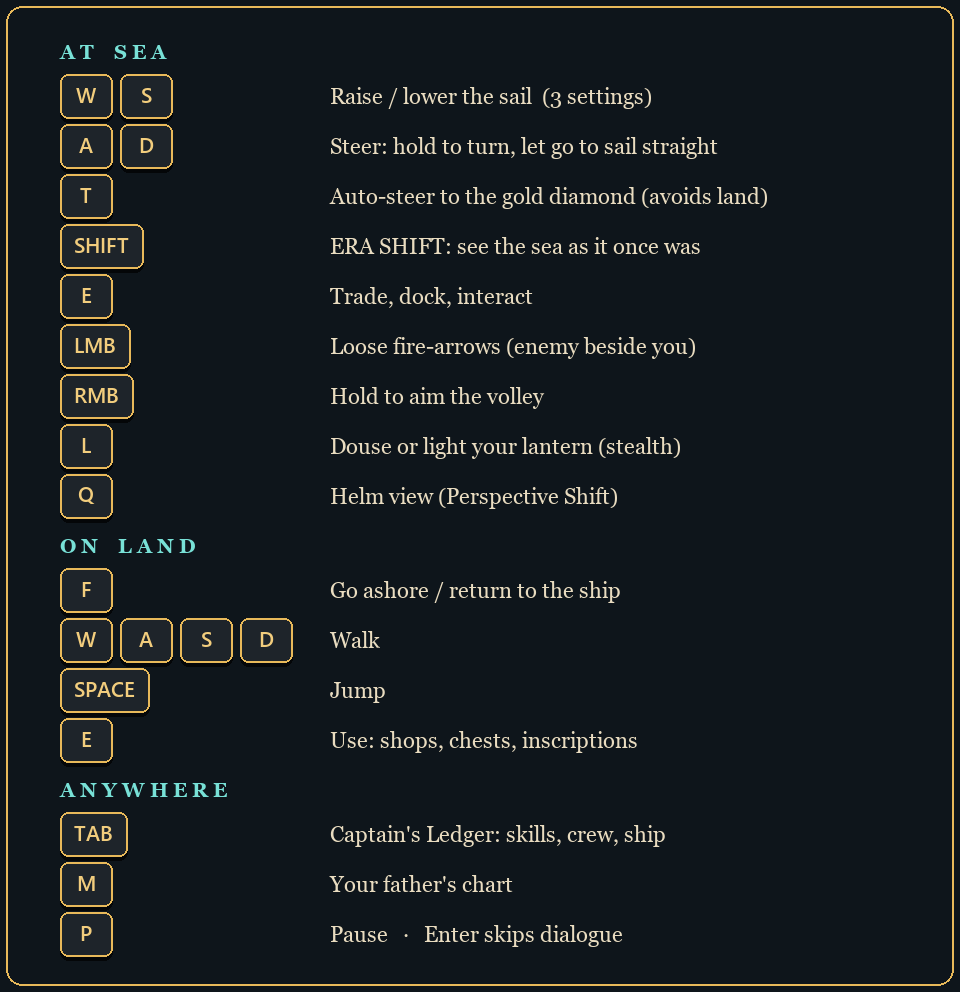

**Tips**

- Click the game once to take the helm. Your mouse then moves the camera.
- The **gold diamond** always shows where to go. Press **T** and your crew will steer there for you.
- Story goals are reached by stopping *near* them on the water. Going ashore with **F** is always optional, and always worth it.
- Your archers fire sideways: put the enemy *beside* your ship, then click.
- Your hull repairs itself after 8 seconds without being hit.
- Press **TAB** whenever you earn skill points. A stronger ship makes the flagships much easier.

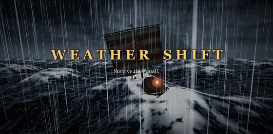

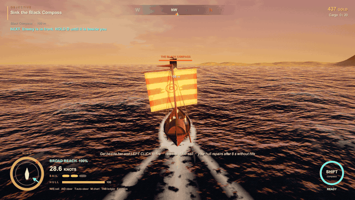

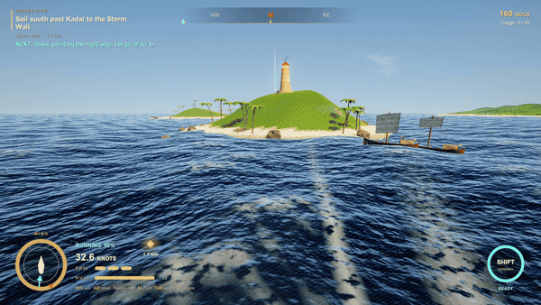

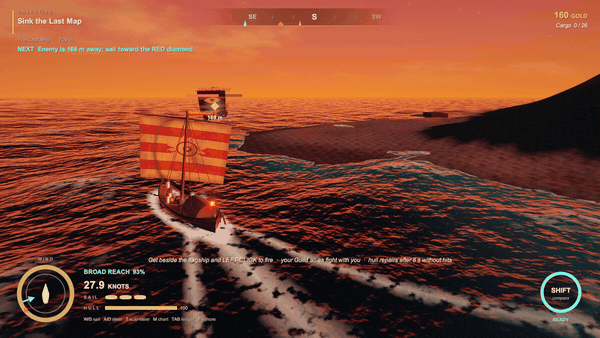

- A complete four-chapter story across the ancient Indian Ocean, from Kerala to Arabia, the Red Sea and Alexandria, with four endings
- Arcade-sim sailing: square-sail physics, steering oar, monsoon winds, tides and wave buoyancy
- On-foot exploration of ports and islands, with shops, treasure and Era Shift vaults
- Skill trees, ship upgrades, ship classes and a crew whose loyalty you have to earn
- Fire-arrow broadsides, ramming, boss flagships, lantern stealth and allied ships that fight beside you
- Trading with different goods and prices in every port
- Dawn, midday, storm, fog, sunset and night
- A fully guided Tutorial Voyage for first-time players
- Original music inspired by Kerala traditions: tanpura drone, a bansuri-style flute in Raga Mohanam, chenda and mizhavu drums, and a conch horn

Built in **Unity 6** for the web. **No imported assets**: every ship, palm tree, Kerala house, temple, lighthouse and island, every texture, sound effect and note of music is generated by code when the game loads. Custom shaders draw the Gerstner-wave ocean with shore foam and ship wakes, the sky with clouds, stars and lightning, the billowing sails and the golden Era Shift memory effect.

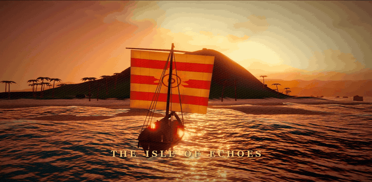

Design, code, art, music and sound: **[YOUR NAME]**

Source code: [GitHub](https://github.com/Agneay-Community-Hub/the-spice-route)

The setting, characters and events are fictional, inspired by the historical trade between the Malabar Coast and the western world.
